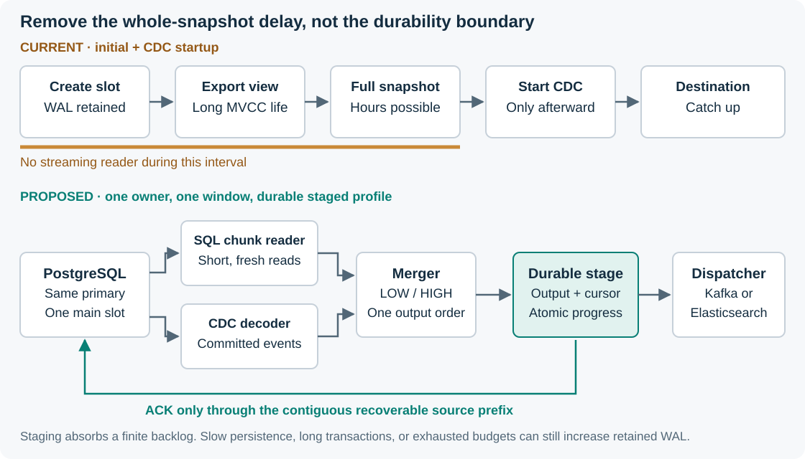
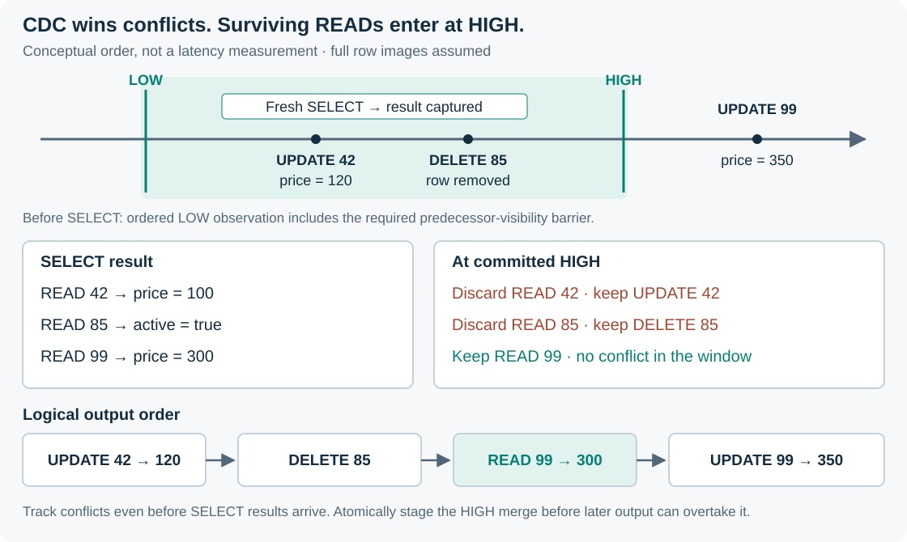

# Online snapshots: feasibility report

**Decision requested:** approve a bounded engineering validation phase, not production release.

| Document control | Value |
|---|---|
| Status | Proposed · independent assessment · implementation not started |
| Date | 2026-10-13 |
| Audience | Engineering leadership, database owners, CDC maintainers, SRE |
| Scope | `go-pq-cdc` and its Kafka and Elasticsearch adapters |
| Source baseline | `4a7e9b094a19935591b691cf8de38546a98b69d0` plus local changes |
| Accountable owner / approvers | Unassigned / CDC maintainer, database owner, SRE, adapter owners |
| Technical authority | [Design RFC](design-rfc.md), subject to review and approval |

## 1. Executive decision

**The feature is technically feasible. Its production readiness is conditional on delivery, recovery, and capacity evidence.**

Add an opt-in incremental snapshot mode. Keep the existing `initial`, `snapshot_only`, and `never` modes. The new mode reads short chunks while CDC continues through an ordered merger.

Recommend transactional LOW/HIGH logical messages, one active chunk window, and primary-side reads. Reuse the existing visibility guard only after validating its placement at the LOW barrier. Compare the temporary-slot alternative during validation, rather than treating either proposal as proven.

For mission-critical deployments, recommend a durable ordered staging interface. The staging store must preserve source progress, output order, and snapshot progress together. The exact backend remains an approval decision. A direct-delivery profile remains possible, but sink outages then retain WAL at the source.

Approve a correctness model, failure tests, an isolated prototype, and capacity measurement.

Do not approve a zero-loss production claim, an implementation deadline, or a promise of bounded WAL during unlimited outages.

## 2. Problem and business impact

For normal CDC startup with `initial`, the connector creates a replication slot before it executes the snapshot. It opens the replication stream only after snapshot execution finishes. The slot retains WAL throughout that interval. This retention includes WAL unrelated to the selected table.

A long snapshot also keeps an exported MVCC snapshot alive. That transaction can delay vacuum cleanup of dead row versions. Smaller chunks do not remove this whole-job dependency.

For large, write-heavy tables, the consequences are source disk pressure, slot invalidation risk, delayed CDC, and expensive restart or rebuild work. Increasing the WAL allowance extends the operating window but does not change the architecture.

*Figure 1. The proposal removes the intentional snapshot-wide reader delay. Safe acknowledgements still depend on recoverable work.*

## 3. Evidence from this repository

| Area | Observed implementation | Feasibility implication |
|---|---|---|
| Startup | `connector.prepareSnapshotAndSlot` completes snapshot execution before `stream.Open` | Add a separate online startup path |
| Snapshot reads | One exported `REPEATABLE READ` view supplies all chunks | Keep this path for legacy modes, not online reads |
| Delivery | Snapshot callbacks have a no-op `Ack`. Row-handler errors are discarded | A real completion contract is a prerequisite |
| CDC ACK | Confirmation tracks a maximum LSN. Heartbeats can use the same path | Add a gap-aware tracker for unfinished obligations |
| Watermarks | `LogicalByte='M'` exists without a decoder case | Implement bounded decoding and commit-aware routing |
| Transactions | Protocol-2 changes wait for commit, but buffers have no byte limit | Bound or spill transaction state, or restrict the first online profile |
| Adapters | In normal CDC startup, both batch loops start after CDC readiness | Separate capture readiness from bootstrap completion |
| Restart | An incomplete legacy job can restart with a new snapshot | Do not reuse that behavior as an online recovery proof |

Existing `snapshot_only` creates no replication slot. Its adapters start batching before snapshot execution.

Source links and exact validation commands are in [Evidence](evidence.md). These findings describe the inspected checkout, not every released version.

The existing snapshot has a common MVCC view. Its sampled LSN is independent of that view. Commits between the LSN sample and snapshot export can appear in both paths. A duplicate-free handoff is therefore not an established baseline guarantee.

## 4. What the feature guarantees

| Included in the proposed contract | Not included |
|---|---|
| Current-state bootstrap alongside CDC | One global cross-table T0 snapshot |
| No stale snapshot overwrite or delete resurrection | Atomic visibility of a source transaction across destinations |
| At-least-once delivery with order-aware replay handling | Exactly-once arbitrary application side effects |
| Checkpointed progress and explicit failure handling | Automatic repair after unreported data loss |
| Resource budgets within a measured workload envelope | Unlimited outage tolerance with finite storage |

The user-selected scope is PostgreSQL 16+, Kafka and Elasticsearch adapter support, and a restricted first release. The RFC proposes single-column integer primary keys and one-to-one row projections first. It excludes mutable keys, filtered snapshots, row-level security, partitioned tables, and distributed snapshot workers until their semantics pass separate gates.

Both adapters must pass the acceptance suite. This does not require one process to write to both destinations at once.

## 5. The merge mechanism

A short SELECT runs between committed LOW and HIGH markers in the same decoded stream. The merger removes snapshot rows whose keys occur in committed CDC within that window. It keeps those CDC events. At HIGH, it inserts the remaining READs before later CDC.

*Figure 2. READ 42 loses to UPDATE 42. READ 85 loses to DELETE 85. READ 99 remains before a later UPDATE 99.*

For concurrent reads, conflict tracking starts before the SELECT result arrives. Otherwise, a change can pass the merger before the buffered row exists.

The original DBLog algorithm briefly pauses event processing around each small SELECT. The proposed concurrent variant adds conflict tracking during that SELECT. The paper supports the reconciliation principle, not this implementation's crash safety or performance.

## 6. Alternatives and recommendation

| Alternative | Benefit | Cost or unresolved issue | Assessment |
|---|---|---|---|
| Larger WAL allowance | Fast operational mitigation | Retention still scales with snapshot time | Temporary mitigation only |
| Existing snapshot plus durable CDC spool | Retains a common snapshot view while capture proceeds | Long MVCC lifetime remains. Spool grows with backlog. Exact handoff still needs work | Valid when a T0-style view is required |
| LOW/HIGH logical messages plus visibility barrier | One source slot, short reads, explicit ordering fence | New decoder, merger, recovery, and visibility proof | Recommended validation candidate |
| Temporary logical slot per chunk | PostgreSQL provides a snapshot tied to that slot's decoding boundary | Repeated slot creation, extra source resources, and an unproven mapping to the main stream | Retain as a comparison candidate |
| Existing CDC platform | Mature operational ecosystem | Migration, runtime footprint, adapter changes, and semantic compatibility | Build-versus-adopt benchmark, not a drop-in assumption |

The temporary-slot proposal in `docs/concurrent-snapshot-design.md` remains unchanged. A snapshot/stream contract for a temporary slot does not establish a contract for a different main slot. The RFC records the missing proof and does not silently merge incompatible algorithms.

Do not use automatic fallback to a full snapshot under WAL pressure. That fallback can retain more WAL and change the target's consistency boundary.

## 7. Delivery and storage feasibility

**Watermarks solve ordering. Durable progress solves safe WAL release. Neither replaces the other.**

A staged profile can release source WAL after it durably records ordered output and sufficient recovery state. Sink delivery then progresses independently. Staging transfers backlog to another finite store. It does not remove backlog.

The selected store must survive the claimed failure model. A pod-local disk does not establish node-loss tolerance. Store loss after source ACK requires an explicit incident and rebuild procedure.

Kafka needs broker-confirmed writes, stable key routing, and ordered retries. Elasticsearch needs per-item bulk confirmation, bootstrap-safe row writes, and protection against stale retries. Error notification alone does not establish durable success.

## 8. Reliability evidence and remaining work

The document-preparation baseline passed root race tests, `go vet`, and seven focused PostgreSQL 16 integration tests. See [Evidence](evidence.md) for the exact scope. No online implementation exists to validate yet.

Two important evidence gaps remain in existing tests:

- The named concurrent-snapshot test starts writes after readiness, which currently follows snapshot completion. It also tolerates missing expected keys.
- The no-walsender test starts its observation interval after readiness and does not require a sample during the actual snapshot.

The current test database uses `fsync=off` and a superuser CDC account. Those tests do not prove crash durability or least-privilege deployment.

The [Validation plan](validation-plan.md) requires deterministic schedules, persistent-target crash tests, exact state comparison, adapter failure tests, and sustained-load measurement. A percentage coverage target cannot replace these tests.

## 9. Risks and controls

| Risk | Impact | Required control | Owner role |
|---|---|---|---|
| ACK crosses unfinished work | Permanent loss after WAL removal | Gap-aware durable progress and failure injection | Core maintainer |
| Read/CDC precedence is incorrect | Stale values or resurrected rows | Reference model and LOW/HIGH schedule tests | Core + database |
| UPDATE lacks unchanged TOAST data | Incomplete bootstrap row | Verified full-image policy or reject unsupported schema | Core + adapter |
| Staging or sink outage | Source or staging disk exhaustion | Measured outage budget and admission control | SRE |
| Old process publishes after takeover | Reordered or duplicate effects | Generation fencing at persistence and delivery boundaries | Core + SRE |
| Legacy API behavior changes | Existing consumer regression | Additive API, separate mode, regression matrix | Core + adapters |
| Slot lost or source identity changes | Unrecoverable replay gap | Fail closed and rebuild a controlled target generation | Database + SRE |

## 10. Delivery phases and approval gates

| Phase | Deliverable | Exit evidence |
|---|---|---|
| P0: baseline | Repair weak assertions and document delivery semantics | Exact-state legacy tests and ACK-gap reproductions |
| P1: algorithm validation | Pure merger model and competing boundary experiments | No invariant violation in published deterministic schedules |
| P2: restricted prototype | One window, primary reads, logical markers, explicit resource limits | Real PostgreSQL write-during-read and abort tests |
| P3: recovery and adapters | Durable staging contract, checkpoints, Kafka and Elasticsearch integration | Hard-crash and ambiguous-response tests |
| P4: operational qualification | Load, outage, permissions, and source-impact evidence | Signed capacity envelope and runbooks |
| P5: canary | Opt-in release with reconciliation | Approved observation period and rollback drill |

No calendar estimate is defensible yet. P0/P1 must establish storage scope, adapter changes, and boundary correctness before implementation estimates become commitments. One core owner, access to PostgreSQL expertise, adapter owners, and an SRE reviewer are required roles, not a staffing estimate.

## 11. Approval checklist

- Approve online current-state semantics and the restricted support matrix.
- Select the durability profile and a staging backend with a stated failure model.
- Assign owner roles and record reviewer sign-off.
- Set target write rate, row width, maximum outage, recovery time, and source-impact budgets.
- Authorize P0/P1 only. Require a new decision before production implementation or rollout.

**Next action:** review RFC decisions D1–D6 and approve the validation work package.

**Document verification:** `test -s docs/online-snapshot/design-rfc.md && test -s docs/online-snapshot/validation-plan.md`. This checks package completeness, not system correctness.

## References

- [DBLog, section 3.2 and Algorithm 1](https://arxiv.org/pdf/2010.12597)
- [PostgreSQL 16 logical decoding concepts](https://www.postgresql.org/docs/16/logicaldecoding-explanation.html)
- [PostgreSQL 16 logical replication protocol](https://www.postgresql.org/docs/16/protocol-logical-replication.html)
- [Repository and test evidence](evidence.md)
