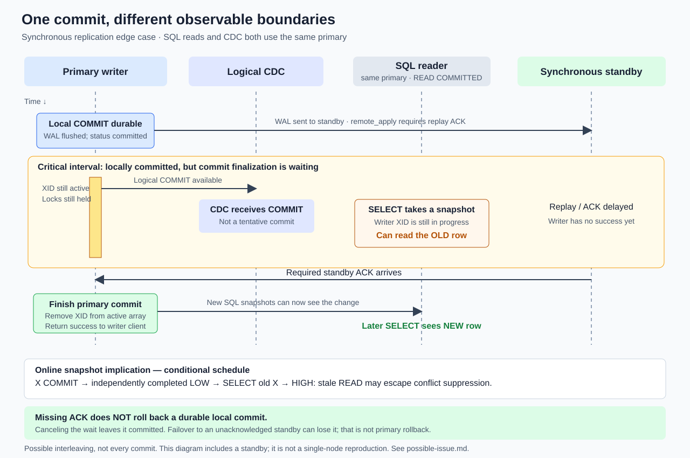

# Possible issue: CDC COMMIT can precede SQL visibility

## Finding

A CDC connector can receive a logical COMMIT from the primary **before a synchronous standby acknowledges that transaction**. At that point, the transaction can already be durably committed on the primary while remaining invisible to a new SQL snapshot and while the writer's COMMIT call is still waiting.

These are separate boundaries:

1. **Local commit:** the primary flushes the COMMIT record to local WAL and records transaction commit status.
2. **Synchronous acknowledgement:** the configured standby requirement is satisfied.
3. **SQL visibility:** the committing backend finishes commit processing and removes the transaction from the active-transaction array.
4. **Client confirmation:** the primary returns COMMIT success to the writer.

The logical decoder can observe the COMMIT record between steps 1 and 2. Receiving that message does not prove steps 2–4 have completed.



## Conditions

The illustrated case has a primary, a synchronous standby, a logical CDC connection, and a separate SQL reader connected to the **same primary**. Use `synchronous_commit = remote_apply` to make the delay explicit: the committing backend waits for standby replay acknowledgement.

Other synchronous modes wait for different milestones: `on` waits for standby WAL flush; `remote_write` waits for standby WAL write. `local` and `off` do not request the remote acknowledgement illustrated here. Synchronous waiting also requires an applicable `synchronous_standby_names` configuration.

READ COMMITTED does not eliminate the issue. It takes a fresh MVCC snapshot at statement start; that snapshot can still classify the writer's XID as in progress. A COMMIT seen on a separate replication connection is not a synchronization barrier for that SQL snapshot.

## Timeline

| Step | Primary writer | CDC connector | SQL reader on primary | Synchronous standby |
|---|---|---|---|---|
| 1 | Update row X | | | |
| 2 | Flush local COMMIT WAL; record committed status | | | |
| 3 | Wait for synchronous acknowledgement; XID remains active and locks remain held | Receive logical COMMIT for X | | Acknowledgement delayed |
| 4 | Still waiting | May deliver X's change | New SELECT snapshot excludes X; reads the old row | Still delayed |
| 5 | Wait completes; finish commit and remove active XID | | | Send required ACK |
| 6 | Return COMMIT success | | A later SELECT sees the new row | |

This is a possible interleaving, not a promise that CDC always outruns SQL visibility. Ordinary SELECTs use MVCC and can read the old row; locking reads can instead block.

## Why this matters to an online snapshot

The LOW/HIGH merge assumes that a page read after the observed LOW boundary can see relevant transactions processed before LOW.

A dangerous schedule is:

```text
CDC:       X COMMIT -> LOW COMMIT -> page read -> HIGH COMMIT
SQL page:                          old X
```

If X's change was processed before LOW, it is outside the LOW–HIGH conflict window. The stale snapshot READ might therefore survive conflict suppression and be delivered after X's newer CDC change.

For this schedule, the LOW marker must be able to complete independently of X, for example through another session that does not wait for the delayed standby. If LOW also waits behind the same synchronous requirement, the exact schedule may be blocked. A synchronous standby alone does not prove every online run encounters the issue.

The current online reader's primary visibility barrier waits for committed-envelope XIDs before returning envelopes to the watermark coordinator. This is separate from the optional general-purpose visibility guard used for downstream SQL lookups or replica visibility.

## Missing ACK does not cause rollback

Once the primary has durably recorded the local COMMIT, failure to receive a standby ACK **cannot roll the transaction back**.

- The COMMIT call can remain blocked waiting for synchronous acknowledgement.
- Canceling the wait or terminating the connection does not undo the local commit. The client might not receive success.
- Primary restart preserves the transaction through local WAL recovery, assuming durable storage and normal durability settings.
- Promoting a standby that never received the transaction can lose it from the new primary's history. That is failover data loss, not rollback on the original primary.

A CDC COMMIT observed during this wait is not a tentative transaction that PostgreSQL later aborts because the ACK is missing.

This durability statement is about the illustrated locally flushed commit. It is not a blanket guarantee for `synchronous_commit=off`, `fsync=off`, or storage that does not honor durability requirements.

## Single-node distinction

Without a standby, the synchronous waiting interval does not exist. The source still separates local WAL commit processing from removal of the active XID, but the synchronous-replication reproduction does **not** independently demonstrate the timing race on a single-node server. Do not present the diagram as a single-node reproduction.

## Evidence and limits

- `integration_test/online_visibility_test.go` contains an existing test that withholds physical replication apply acknowledgement while logical CDC proceeds. It is test instrumentation, not a complete replaying standby or HA qualification fixture.
- The online suite containing that test passed on the five images recorded in `specs/verifications/e02-pg15-17-result.md`. No new reproduction was run for this document.
- PostgreSQL 17 source was inspected while preparing these notes. `RecordTransactionCommit` calls `SyncRepWaitForLSN` after local commit processing and explicitly notes that the XID remains in the process array and retains locks. `CommitTransaction` calls `ProcArrayEndTransaction` afterward.
- `SyncRepWaitForLSN` explicitly states that cancellation cannot abort the already locally committed transaction.

## Primary references

- [PostgreSQL 17 transaction commit implementation](https://github.com/postgres/postgres/blob/REL_17_STABLE/src/backend/access/transam/xact.c): `RecordTransactionCommit`, `CommitTransaction`, and `ProcArrayEndTransaction` ordering.
- [PostgreSQL 17 synchronous replication implementation](https://github.com/postgres/postgres/blob/REL_17_STABLE/src/backend/replication/syncrep.c): `SyncRepWaitForLSN` and cancellation warnings.
- [PostgreSQL 17 synchronous commit configuration](https://www.postgresql.org/docs/17/runtime-config-wal.html#GUC-SYNCHRONOUS-COMMIT).
- [PostgreSQL 17 READ COMMITTED isolation](https://www.postgresql.org/docs/17/transaction-iso.html#XACT-READ-COMMITTED).

Stable-branch source URLs are moving references. This note documents an edge case and its implications; it is not a new bug-fix or production-readiness claim.
